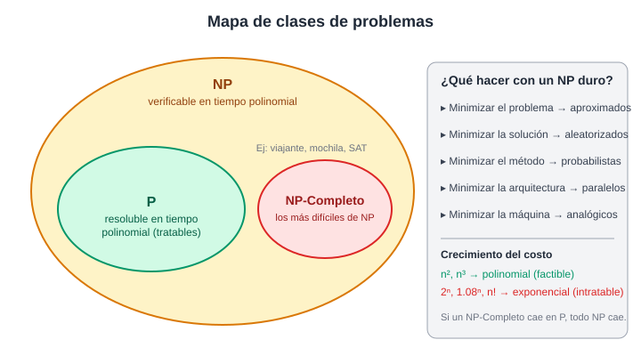
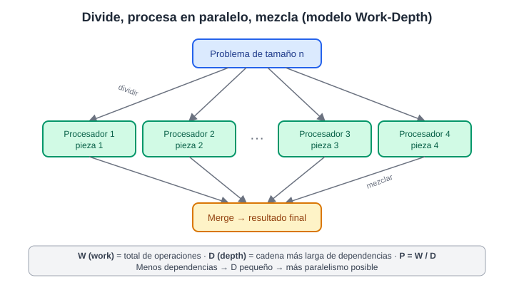
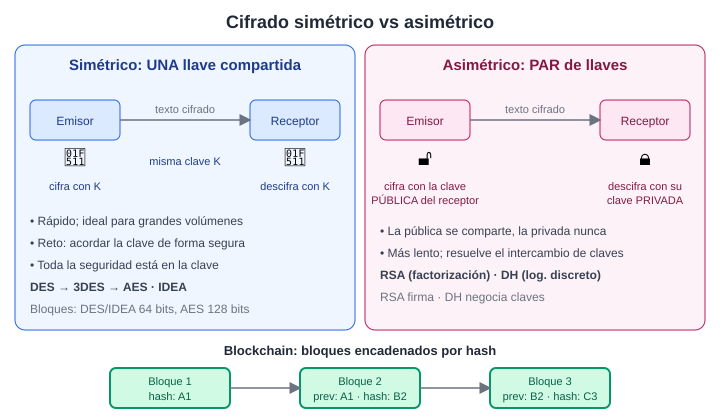

# Unidad 1: Intratabilidad

## 1. Descripción

No todos los problemas se pueden resolver en un tiempo razonable. Un problema es **tratable** si existe al menos un algoritmo que lo resuelve en tiempo aceptable, e **intratable** si no es factible obtener su solución. Para analizarlo se usan *modelos de computación* (modelo uniforme, costo logarítmico, máquinas de Turing, cálculo lambda, entre otros). El más común en análisis de algoritmos supone operaciones primitivas de costo unitario.

La frontera práctica está entre el crecimiento **polinomial** (n², n³), que escala bien, y el **exponencial** (2ⁿ, 1.08ⁿ), que se vuelve inviable rápidamente. Ejemplos: el ajedrez en tablero N×N (2^(n²)), el retorno del inversionista (1000 × 1.08ⁿ) y la tabla de búsqueda del Chinese Room (1400ⁿ).

Cuando un problema es difícil, no se abandona: se relajan sus requerimientos para obtener un algoritmo factible y se define su aplicabilidad.

## 2. Características fundamentales

- **Clase P**: se resuelve con una máquina determinista en tiempo polinomial. Son los problemas "fáciles".
- **Clase NP** (*Non-deterministic Polynomial*): una solución candidata se **verifica** en tiempo polinomial. P ⊆ NP.
- **NP-Completo**: los problemas más difíciles de NP.
  - Todos son polinomialmente transformables entre sí.
  - Si uno se resuelve en tiempo polinomial, todos los de NP también.
  - Si se prueba que uno no tiene algoritmo rápido, ninguno lo tiene.
- **Transformación polinomial**: P1 → P2 en tiempo polinomial. Si P2 es fácil, P1 es fácil. Si P2 es duro, P1 no es más duro que P2.
- **Exponencial no siempre es malo**: Simplex (Dantzig) y Elipsoide resuelven problemas difíciles en tiempos prácticos.
- **Qué hacer ante un NP duro** (minimizar un requerimiento):
  - Problema → algoritmos aproximados.
  - Solución → algoritmos aleatorizados.
  - Método → algoritmos probabilistas.
  - Arquitectura → computación paralela.
  - Máquina → métodos analógicos.
- **5 dimensiones de un algoritmo**: factibilidad, correctitud, predictibilidad, aleatoriedad y límite (si se detiene).

## 3. Imagen

---

# Unidad 2: Algoritmos Paralelos

## 1. Descripción

Un algoritmo paralelo se ejecuta en **piezas simultáneas sobre distintas unidades de procesamiento**. Ejemplo: buscar primos entre 1 y 100 000 asignando un subconjunto de números a cada procesador. Su importancia crece porque los procesadores multi-core están en PC, tablets y smartphones, además de servidores multi-socket y sistemas distribuidos.

**Cuidado con la confusión**: usar hilos, varios cores o afinidad de procesador no implica, por sí solo, tener un algoritmo paralelo. Un algoritmo paralelo siempre (1) divide el problema en tareas independientes y (2) mezcla los resultados parciales en un resultado final.

Para estudiarlos se necesitan modelos. Unos describen el hardware (variantes de la RAM con múltiples procesadores). Otros, como **Work-Depth**, se centran en el algoritmo abstracto.

## 2. Características fundamentales

- **Modelos de hardware** (extensiones de la RAM, con memoria como factor crítico):
  - *Local Memory*: cada procesador tiene su memoria y se comunican por una red.
  - *Modular Memory*: la memoria está en módulos y los procesadores acceden a ella solo a través de una red.
  - *PRAM*: acceso directo y aleatorio a toda la memoria, con un bus de control y protocolos de coherencia.
- **Instrucciones nuevas** requeridas: acceso concurrente a memoria compartida, sincronización y operaciones globales sobre datos.
- **Modelo Work-Depth** (costo = operaciones + dependencias):
  - **W (Work)**: total de operaciones.
  - **D (Depth)**: camino más largo de dependencias.
  - **P = W / D**: entre más lejos de 1, mayor paralelismo posible.
- **Notación del modelo basado en lenguaje**:
  - `{a*a : a ∈ [3,-4,-9,5] | a > 0}` aplica la operación en paralelo a toda la colección, con filtro opcional.
  - `in parallel do A := f1(X); B := f2(Y)` ejecuta ambos statements a la vez y termina cuando ambos terminan.
- **Reglas de medición**:
  - Toda operación primitiva cuesta 1.
  - Work de aplicar a una secuencia = suma de los Work individuales.
  - Depth = el máximo entre los Depth individuales.
  - Parallel-do: Work = suma, Depth = máximo.
- **Ejemplo**: `{a*a : a ∈ [3,-4,-9,5] | a > 0}` evalúa solo 3 y 5, con W = 2, D = 1 y P = 2.
- **Estrategia de diseño típica**: Divide y Vencerás (resolver subproblemas y hacer *merge*).

## 3. Imagen

---

# Unidad 3: Algoritmos de Cifrado

## 1. Descripción

El cifrado protege la confidencialidad de la información transformando un texto en claro en un texto cifrado que solo puede revertir quien conoce la clave. Hay dos familias:

- **Simétricos** (clave única o secreta): emisor y receptor usan la **misma clave** para cifrar y descifrar, y deben acordarla previamente. Un atacante no gana nada con conocer el algoritmo: toda la seguridad está en la clave.
- **Asimétricos** (clave pública): cada persona tiene un **par de claves**. La pública se entrega a cualquiera y la privada se guarda en secreto. Lo cifrado con la pública solo lo descifra la privada.

Como extensión, **Blockchain** usa criptografía (hashes) para construir un registro distribuido, descentralizado y resistente a alteraciones.

## 2. Características fundamentales

**Simétricos**

- **DES** (1976, estándar FIPS)
  - Cifrado por bloques de 64 bits.
  - Clave de 64 bits, de los cuales 56 son efectivos y 8 son de paridad.
  - 16 rondas con estructura Feistel: cifrar y descifrar son casi iguales, solo cambia el orden de las subclaves.
  - Hoy es inseguro: sus claves se han roto en menos de 24 horas.
- **Triple DES (3DES/TDES)**
  - Aplica DES tres veces. En 3TDES las tres claves son distintas. En 2TDES la 1ª y la 3ª son iguales.
  - Se considera seguro en la práctica, aunque lento.
- **AES / Rijndael** (FIPS 197, 2001)
  - Cifrado por bloques, sustituto de DES.
  - Rondas: SubBytes (sustitución), ShiftRows (rotación de filas), MixColumns (mezcla de columnas) y AddRoundKey (XOR con la clave de ronda).
  - Es de los más usados en criptografía simétrica.
- **IDEA** (1991, Lai y Massey)
  - Bloques de 64 bits y clave de 128 bits.
  - 8 rondas más media ronda de salida.
  - Su seguridad viene de combinar suma modular, multiplicación modular y XOR, que son algebraicamente "incompatibles".

**Asimétricos**

- **RSA** (1977, Rivest, Shamir y Adleman)
  - Se basa en la dificultad de factorizar enteros muy grandes.
  - Claves de 512 a 2048 bits (típico 1024; hoy se recomienda 2048 o más).
  - Se usa sobre todo para **firmar**.
- **Diffie-Hellman** (1977)
  - Se basa en logaritmos discretos.
  - Se usa para **negociar claves**.
  - Requiere autenticación adicional para evitar el ataque man-in-the-middle.

**Blockchain**

- **Block**: lista de registros de un periodo, con reglas definidas al crear la red.
- **Chain**: el hash de cada bloque se incluye en el siguiente, lo que hace inviable alterarlos.
- **Network**: cada nodo guarda una copia completa y ninguno es más confiable que otro.
- **Consensus mechanism**: regla que permite aceptar transacciones entre nodos que no confían entre sí (problema de los generales bizantinos).
- Tipos: public, permissioned y private.

## 3. Imagen

