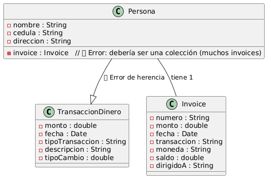

# Discussion Sessions (Conversatorios)

Discussion sessions are optional activities that allow students to participate on the Codex platform at https://wallstreet-zeta.vercel.app for an additional 7% of the course grade throughout the semester. There will be 5 discussion sessions in total, where students can "buy" shares through demonstrated knowledge. Those shares may rise or fall in price on the Codex market, and students can redeem them for course percentage points whenever they choose. The accumulated percentage redeemed during the semester will be added to the total grade at the end of the semester.

## Discussion Session Rules

1. The instructor will publish the topic and the expected mastery levels at least 5 days before the discussion session.

2. In each discussion session, a student may buy a maximum of 100 shares.

3. On the day of the discussion session, the instructor will publish the "price sheet," which defines the criteria used to determine the value of each student's contribution during the session. This corresponds to the shares "purchased," from 0 to 100.

4. The instructor will record the discussion session and take notes. The transcription, notes, and price sheet will be analyzed by an AI agent that decides how many shares each participant acquires, in order to avoid subjective bias.

5. Each discussion session will last a maximum of 12 minutes in groups of up to 5 people. Only discussion session participants may be present; all other students will wait outside.

6. Students will know the topic and the expected scope of mastery, but they will not know the questions or the direction of the conversation led by the discussion moderator (the instructor).

7. Students may not read material or look up answers through any digital means or books, but they may use them to show something they prepared in advance for the topic and question at hand.

8. Each student may participate for a maximum of 2 minutes, which does not necessarily have to be consecutive. Being concise is strongly recommended.

9. When a student addresses an aspect of the topic in the discussion session, if another student—or the same student—brings up that aspect or topic again, it will no longer be counted. This is to avoid repeating matters already discussed. In other words, contributions must always be incremental.

10. In each discussion session, the moderator's questions or focus areas are different.

---

# Discussion Session #1 - Friday, August 28th

## Topic

The power of the Java API: https://docs.oracle.com/javase/8/docs/api/. The Java API is the extensive documentation of Java's object-oriented language. It covers not only the core language, but also a broad collection of packages and classes that extend Java's functionality to solve many types of applications and solutions in the market. Understanding how to read, navigate, and use it is of great importance in Java's commercial and scientific environments.

*Expected mastery*

- What is the power and foundation of `java.lang`
- Why do primitives exist in `java.lang`? There are primitives such as `int`, `float`, `char`, `boolean`, etc., but there are also classes such as `Integer`, `Float`, `Byte`, `Boolean`, etc.
- What are standard in and out, why are they called `InputStream` and `OutputStream`, and why is it said that in Java everything is a file
- How the JVM manages processes and threads, and in particular how the programmer manipulates them with the `Thread` class
- What skills and capabilities can be gained by mastering packages such as `java.math`, `java.time`, and `java.util`
- Why some packages are `java.*` and others are `javax.*`
- How would you explain reading the Java API help documentation: what it consists of, how it is organized, and why it sometimes refers to Implemented Interfaces and Direct Known Subclasses
- How these APIs are affected by different versions of Java and the JDK


## Market Sheet
 
Conversation drivers: 

1. Por qué si existen classes para Integer, Boolean, Float, Byte, etc existen primitivas? incluso esas clases muchas veces son creadas con primitivas, o tienen métodos que retornan primitivas. Si las primitivas tienen métodos para que existen las clases. Deberían ser una o la otra únicamente?

2. Cómo java.lang da soporte a las Excepciones y Errores en todo el lenguaje?

3. Si java.lang.Math me da un amplio repertorio de operaciones, para que tengo el paquete de java.math

4. Que controles y como puede administrar java lo que son procesos y threads desde las classes en java.lang

5. Por qué existen los Input y Output streams, qué es el concepto de stream que nos da java?

6. Cuáles son los alcances de java.lang.System class

7. Cuándo se construyen sistemas que van a ser usados en múltiples países, que ventajas me dota java.time

8. Qué tipo de algoritmos, operaciones, técnicas, estructuras y/o soluciones puedo fácilmente crear con java.util, donde se vuelve un aliado en la programación? 

9. Por qué será que Calendar y Date están en java.util y no en java.time. 

10. Cómo podríamos hacer que la AI use cierta versión del JDK, y que solo genere código oficial del java api de la versión específica? Cómo podríamos hacer incluso que ciertos métodos o clases del JDK, los use de únicamente la forma en que queramos todo el tiempo?


Shares: 

1. El estudiante dió más que definiciones teóricas de los conceptos, habló de casos concretos de uso, correlacionó el concepto con otros existentes para ampliar la comprensión. 20 shares.

2. El estudiante realizó programación ejemplo en código java para demostrar los aspectos estudiantes y para soportar las afirmaciones que está aportando. 30 shares.

3. El estudiante logró crear deducciones propias, simplificaciones propias, teorías propias sobre el entendimiento y uso de los conceptos y técnicas que está aplicando. 20 shares.

4. Pudo correlacionar los temas estudiados y expuestos con el entorno del mundo real, ya sea dentro del contexto de sus estudios en ingeniería de sistemas, o también contextualizando situaciones de desarrollo de programas de la vida real donde lo expuesto consolida esos escenarios. 25 shares.

5. Para aquello que no supo una respuesta, logro conectar múltiples conceptos estudiados para llegar a una respuesta que aún tal vez no sea correcta, tiene coherencia técnica. 15 shares.

6. No solo glorificó las caracteristicas del lenguaje, los paquetes, los alcances poniendo java como un gran lenguaje y plataforma de programación, si no que más bien, logró evidenciar en teoría y en código, deficiencias, mejoras y retos de uso de los diferentes paquetes, clases o implementaciones discutidas sobre su intervensión.  25 shares. 

---

# Discussion Session #2 - Friday, September 11th, 2026

## Topic
There are concepts that are pillars for mastering the object-oriented paradigm in any programming language: abstraction, encapsulation, inheritance, and polymorphism. The student not only comes to master these concepts in theory and in Java, but also masters them in practice and extrapolates them to other programming languages.

*Expected mastery*

- The student can explain real situations in class design where the principles of encapsulation are met or not met, knowing and mastering the scenarios in which the use of public, private, and protected is appropriate. They understand the effect of those modifiers on classes, constructors, methods, and instance variables.

- Given example problems, they can mentally design in seconds the classes needed to solve a variety of problems, applying a correct separation of concerns.

- Fully masters how inheritance is done not only in Java but also in some other language; thoroughly understands aspects associated with inheritance, such as the use of abstract classes, abstract methods, and the use of this and super when there is inheritance, in both methods and constructors. Knows how to build multi-level inheritance, how to override inherited methods, and also how to extend them when both the functionality programmed in the parent and the additional code written in the child are required in a given order; and applies those skills to real-life examples in different languages.

- Is able to imagine and create new possibilities and worlds supported by polymorphism; knows and fully masters how to achieve polymorphic classes and methods by means of concrete classes, abstract classes, and interfaces. Combines polymorphism and inheritance skillfully and recognizes their particularities in Java and in some other language.

- The student masters all of the above without reading documentation, and can explain it to other people fluently, with real examples and situations that could arise in programs they have built or could be building in the future.

- The 4 pillars are identifiable not only in code and in theory, but also graphically using UML.

## Market Sheet

Shares:
1. El estudiante en su explicación logra extraer capacidades al poder de la herencia, más allá de solo la herencia de carácterístias como atributos, si no más bien, asociados a encapsulamiento y polimorfismo.
30 shares.

2. Deja claro los momentos en los que es conveniente usar herencia de clases versus interfaces, dejando claro las ventajas y momentos donde es mejor una técnica que otra. 35 shares.

3. El estudiante tiene claro las limitaciones de las interfaces pero también la flexibilidad de sus ventajas, incluso al punto que abstrae el porque el java api o alguno de los paquetes de java posee Interfaces que podemos implementar. 25 shares. 

4. El estudiante logra detectar los problemas en el diseño presentado y puede proponer un mejor diseño que arregle el presentado. 25 shares.




```
@startuml

class TransaccionDinero {
    - monto : double
    - fecha : Date
    - tipoTransaccion : String
    - descripcion : String
    - tipoCambio : double
}

class Persona {
    - nombre : String
    - cedula : String
    - direccion : String
    - invoice : Invoice   // Error: debería ser una colección (muchos invoices)
}

class Invoice {
    - numero : String
    - monto : double
    - fecha : Date
    - transaccion : String
    - moneda : String
    - saldo : double
    - dirigidoA : String
}

Persona -- Invoice : tiene 1
Persona --|> TransaccionDinero : ❌ Error de herencia

@enduml
```

---

# Discussion Session #3 - Wednesday 4th, November 2026.

## Topic

In this session, we will discuss the power and capabilities that object-oriented design patterns such as Singleton, Abstract Factory, and Adapter can provide.

The session will cover their theory, how to implement them in Java, their constraints and particular characteristics, as well as specific Java language features and instructions used when programming these patterns. We will also examine the influence of inheritance and polymorphism on these patterns, new language features and techniques learned to implement them, and real-world use cases with code examples demonstrating how to apply these patterns.

Reference: https://refactoring.guru/design-patterns/catalog .

## Market Sheet

Shares:
1. El estudiante logra explicar detalles teoricos y practicos de los 3 patrones. 35 shares.
2. El estudiante logra explicar detalles teoricos y prácticos de solo 2 de los patrones. 25 shares.
3. El estudiante logra explicar detalles teoricos y prácticos de solo 1 de los patrones. 15 shares.
4. Cuando el estudiante explica los patrones hace énfasis en lo que logra hacer la herencia y el polimorfismo en el patrón. 30 shares.
5. Logra establecer las reglas del patrón, los actores y el flujo de ejecución con usos reales o aplicaciones reales del patrón con algún caso ejemplo. 50 shares. 

---

# Discussion Session #4 #5 - Wednesday 4th y Friday 6th, November

## Topic

From specification to object model: spec-driven development, UML class diagrams, Mermaid, and design patterns in Java.

This session treats software development as an engineering process, not as “writing classes until something compiles.” Students will argue how a specification drives the design, how that design is made visible with UML class diagrams and Mermaid, and how inheritance, polymorphism, and design patterns become the vocabulary for turning a problem into a Java object model.

The conversation will move among three layers that must stay consistent:

1. **Process.** Spec-driven development: what a spec is for, how it constrains design decisions, how it reduces ambiguity before code, and how AI can help produce, critique, and refine specs and diagrams without replacing the engineer’s judgment.
2. **Representation.** UML class diagrams as the contract of the object model (classes, attributes, operations, associations, inheritance, interfaces, multiplicity, responsibilities). Mermaid as a practical way to sketch the same ideas quickly, iterate in conversation, and keep the diagram close to the spec.
3. **Construction.** Design patterns applied with inheritance and polymorphism, mixed when a single pattern is not enough, and verified in Java: the student must be able to say not only *which* classes exist, but *why* each class exists, what it is responsible for, and how those responsibilities would be coded.

Students will be challenged on the fly to invent models for unfamiliar problems: name at least a first cut of the classes, assign responsibilities, choose relationships (association, composition, inheritance, interface), pick and combine patterns, and defend how that design would look in Java. The goal is not a perfect catalog of patterns, but fluency: object strategy, diagram literacy, and the ability to keep process, diagram, and Java code aligned.

*Expected mastery*

- Explain spec-driven development: how a written spec (problem, actors, constraints, invariants, acceptance criteria) precedes and governs class design; how changing the spec should change the model.
- Read and produce UML class diagrams: classes, fields and methods, visibility, associations and multiplicity, generalization, realization of interfaces, and notes that capture responsibilities.
- Express the same model in Mermaid (`classDiagram`), knowing what Mermaid can and cannot represent compared with full UML, and when a quick Mermaid sketch is enough to reason about a design.
- Given a problem stated only in words, propose an object strategy: at least five classes, the responsibility of each class, and how they collaborate. Separate “who knows,” “who does,” and “who creates.”
- Apply inheritance and polymorphism as design tools, not as default structure: when a superclass or an interface is justified, when composition is better, and how polymorphic types keep client code stable.
- Use design patterns (structure, intent, participants, and typical Java shape) and, above all, combine patterns when the problem needs more than one (for example factory + strategy, singleton + facade, adapter + decorator, observer + command). Justify the mix against the spec.
- Translate the design into Java verbally with language-level precision: packages, constructors, access modifiers, abstract classes vs interfaces, overrides, `final`, collections as associations, and where the pattern actually appears in code.
- Identify convenient uses of AI in this pipeline (drafting specs, generating first-cut diagrams, proposing class lists, reviewing pattern fit) and how to tighten AI output: constraints, examples, forbidden designs, JDK version, “implement this diagram, do not invent classes,” iterative critique against the spec.

## Market Sheet

Shares:

1. El estudiante logra explicar con amplitud los temas que se le han preguntado, no limitándose a la respuesta específica sino correlacionando temas y dando ejemplos. 35 shares.

2. El dominio de Java es notorio en la explicación: detalla verbalmente aspectos del lenguaje que complementan la parte técnica de su rationale. 30 shares.

3. Entiende los procesos de ingeniería de software e identifica usos convenientes de AI, así como cómo afinar la precisión de los resultados de AI.

4. El estudiante puede crear diseños de problemas al vuelo, detallando al menos 5 clases que podría necesitar para solucionar el problema y cuáles son las responsabilidades de cada clase.

5. Demuestra agilidad con los patrones de diseño: uso, aplicación, estructura y, sobre todo, cómo mezclar patrones unos con otros para lograr una solución. 45 shares.

---